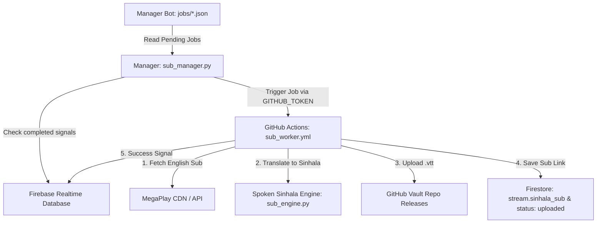

# 🎬 AniShift Subtitle Bot & Cloud Worker System

A high-performance subtitle automation engine for AniShift.
Automatically extracts MegaPlay English subtitles, accurately translates them to **natural spoken Sinhala (කටවහර)** using Google Neural Translation + Spoken Dictionary, uploads `.vtt` tracks to permanent GitHub Releases, and links them directly to episode documents.

---

## 🏗️ Architecture

---
