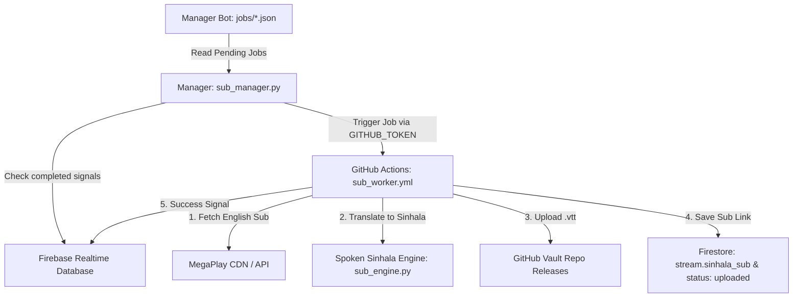

# 🎬 AniShift Subtitle Bot & Cloud Worker System

A high-performance subtitle automation engine for AniShift.
Automatically extracts MegaPlay English subtitles, accurately translates them to **natural spoken Sinhala (කටවහර)** using Google Neural Translation + Spoken Dictionary, uploads `.vtt` tracks to permanent GitHub Releases, and links them directly to episode documents.

---

## 🏗️ Architecture



---

## 🔑 GitHub Repository Secrets Configuration

When you create the GitHub repository for the Cloud Worker (e.g., `vinothgeethika/anishift-megaplay-sub-worker`), go to:
**Settings ➔ Secrets and variables ➔ Actions ➔ New repository secret** and add the following secrets:

| Secret Name | Value Description | Purpose |
| :--- | :--- | :--- |
| `FIREBASE_JSON` | Content of `anishift-core.json` | Cloud Runner authentication with Primary Database. |
| `BACKUP_FIREBASE_JSON` | Content of `anisora-core.json` (Optional) | Cloud Runner authentication with Backup Database. |
| `FIREBASE_DB_URL` | Your Firebase RTDB URL | Realtime Database URL for emitting job completion signals. |
| `SUB_GITHUB_TOKEN` | Personal Access Token (`ghp_...`) with `repo` scope | Write token to create GitHub releases and upload `.vtt` assets. |
| `SUB_GITHUB_REPO` | Target GitHub repository (e.g., `Owner/sub-vault`) | Vault repository where subtitle files are hosted. |

---

## 💻 Local / VPS Manager Setup (`.env`)

Inside `.env`:

```env
# GitHub Dispatch Configuration
GITHUB_TOKEN=your_github_personal_access_token_here
GITHUB_WORKFLOW_REPO=owner/worker-repository-name

# Subtitle Vault Repo for Releases
GITHUB_REPO=owner/subtitles-vault-repo

# Firebase RTDB URL
FIREBASE_DB_URL=https://<your-project>-default-rtdb.firebaseio.com/

# Concurrency & Timeouts
MAX_CONCURRENT_JOBS=15
JOB_TIMEOUT_SECONDS=900
```

### Running the Subtitle Manager:
```bash
pip install -r requirements.txt
python sub_manager.py
```
